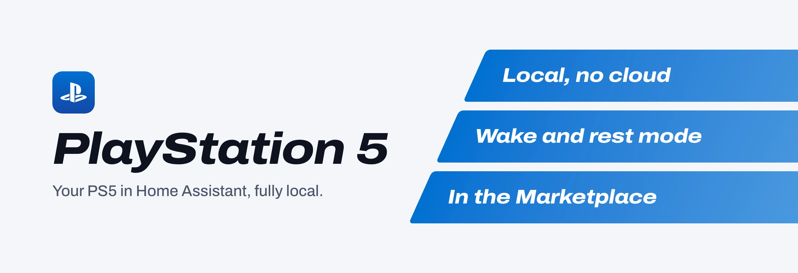

<div align="center">

<picture>
  <source media="(prefers-color-scheme: dark)" srcset="docs/images/readme-title-dark.webp" />
  
</picture>

[](https://github.com/SH1FT-W/playstation-5/releases/latest)
[](https://www.home-assistant.io)
[](https://hacs.xyz)

<a href="https://sh1ft-w.github.io/playstation-5"><b>Website</b></a>&emsp;<a href="#get-started">Get started</a>&emsp;<a href="#entities">Entities</a>&emsp;<a href="#examples">Examples</a>&emsp;<a href="CHANGELOG.md">Changelog</a>

</div>

<br/>

Your PS5 in Home Assistant, the way the PS App sees it at home: **on, rest mode or off, wake it up, send it to sleep.** Straight over your network, without cloud, MQTT or an extra app.

The PS5 does not tell the local network which game is running. If you want the game, trophies and online status too, add your PlayStation Network login. Control never goes through it.

## What you get

|  | Local | With PSN login |
|:--|:--:|:--:|
| On, rest mode or off, every 5 seconds | ✓ | ✓ |
| Wake up (about 5 seconds) and rest mode | ✓ | ✓ |
| Play time today and this week | ✓ | ✓ |
| System software update available | ✓ | ✓ |
| Current game with cover | | ✓ |
| Play time per game | | ✓ |
| Trophies, online status, PS Plus, avatar | | ✓ |

**New in 26.11:** play time sensors for daily limits, and the PSN login can be switched on right in setup. Every change is in the [changelog](CHANGELOG.md).

<a id="get-started"></a><a id="install"></a><a id="set-up"></a>
## Get started

[](https://my.home-assistant.io/redirect/hacs_repository/?owner=SH1FT-W&repository=playstation-5&category=integration)

Before you start, check three switches on the PS5: **Enable Remote Play**, and under **Power Saving > Features Available in Rest Mode** both **Stay Connected to the Internet** and **Enable Turning On PS5 from Network**. Without them it cannot be woken.

1. **Install it.** Search for **PlayStation 5** under **Settings > Marketplace** (called HACS before Home Assistant 2026.11), download it and restart Home Assistant.
2. **Add the console.** It usually shows up under **Settings > Devices & services > Discovered**. If not, choose **Add integration > PlayStation 5**. It has to be on or in rest mode.
3. **Pair it.** On the PS5 open **Settings > System > Remote Play > Pair device** and enter the 8-digit PIN in Home Assistant.
4. **Your PSN account.** Enter the account ID if you know it (it is filled in when the PlayStation Network integration is set up). Otherwise paste an NPSSO token: sign in at playstation.com, open https://ca.account.sony.com/api/v1/ssocookie and copy the value after `npsso`. Leave **Also use the NPSSO token for the PSN cloud** ticked to switch on game, trophies and online status right away.

You can add the PSN login later under **three dots > Configure**. A new IP address is picked up by itself; if not, use **three dots > Reconfigure**.

<details>
<summary>Install by hand</summary>

1. Download the [latest release](https://github.com/SH1FT-W/playstation-5/releases/latest).
2. Copy `custom_components/ps5` into `/config/custom_components/` and restart Home Assistant.

</details>

<a id="entities"></a>
## Entities

IDs for a console named "PlayStation 5". Names are in English and German.

| Entity | Shows |
|:--|:--|
| `media_player.playstation_5` | Playing (with game and cover), on or off. Switches on and off. |
| `switch.playstation_5_power` | On = running, off = rest mode. The one for automations. |
| `sensor.playstation_5_status` | On, rest mode or off. A console that does not answer counts as off, never as an error. |
| `sensor.playstation_5_play_time_today`<br>`sensor.playstation_5_play_time_this_week` | Minutes the console was on. Today from midnight, the week from Monday. Kept across restarts. |
| `update.playstation_5_system_software` | Installed version against Sony's latest, with release notes. |

<details>
<summary>With the PSN login (12 more)</summary>

| Entity | Shows |
|:--|:--|
| `sensor.playstation_5_game` | Current game, attribute `title_id` |
| `sensor.playstation_5_play_time_in_game_today` | Minutes in a game today, attribute `games` per game |
| `sensor.playstation_5_online_status`, `_last_online`, `_online_id` | Your PSN profile |
| `sensor.playstation_5_trophy_level`, `_trophy_level_progress` | Trophy level |
| `sensor.playstation_5_platinum_trophies`, `_gold_`, `_silver_`, `_bronze_trophies` | Trophy counts |
| `sensor.playstation_5_psn_login_expires` | When the current login token runs out |
| `binary_sensor.playstation_5_playstation_plus` | PS Plus active |
| `image.playstation_5_game_cover`, `image.playstation_5_avatar` | Cover and avatar |

</details>

<a id="examples"></a>
## Examples

Switch the TV to the console's input when the PS5 starts:

```yaml
triggers:
  - trigger: state
    entity_id: switch.playstation_5_power
    to: "on"
actions:
  - action: media_player.select_source
    target:
      entity_id: media_player.living_room_tv
    data:
      source: HDMI 2
```

<details>
<summary>Rest mode after two hours a day</summary>

```yaml
triggers:
  - trigger: numeric_state
    entity_id: sensor.playstation_5_play_time_today
    above: 120
actions:
  - action: switch.turn_off
    target:
      entity_id: switch.playstation_5_power
```

</details>

## Your data

- **Control stays at home.** Status, wake-up and rest mode go straight between Home Assistant and the console.
- **Your PSN login stays in Home Assistant** and is only sent to Sony's own servers. Sony's token runs out after 10 days, so Home Assistant fetches a new one 3 days before. You are only asked again when Sony rejects the NPSSO (about every two months).
- **Diagnostics leave out** pairing keys, tokens, account IDs, IP and MAC address.

## Good to know

- Wake-up works from rest mode only, not when the console is fully off.
- If the PS5 refuses rest mode (it does for about a minute after waking up), Home Assistant retries in the background and keeps showing off.
- No game launching or button presses. That would need a full Remote Play session.
- System updates are installed by the PS5 itself in rest mode. The update entity only shows that one is there.

<details>
<summary>Troubleshooting</summary>

- **"The PS5 is not waiting for pairing".** Keep **Pair device** open on the PS5 until Home Assistant is done.
- **Switching off asks for a new PIN.** The device was removed on the PS5 under Remote Play. Pair again.
- **Wake-up does nothing.** Check the three rest mode switches under [Get started](#get-started).
- **Cloud entities unavailable.** Sony is not reachable or the login was rejected. Look at **Settings > Repairs**.
- **Debug log:**

  ```yaml
  logger:
    logs:
      custom_components.ps5: debug
  ```

When you open an [issue](https://github.com/SH1FT-W/playstation-5/issues), attach the diagnostics (**Settings > Devices & services > PlayStation 5 > three dots > Download diagnostics**). Never post your NPSSO token.

</details>

<details>
<summary>Remove</summary>

1. **Settings > Devices & services > PlayStation 5 > three dots > Delete**.
2. On the PS5, remove the device under **Settings > System > Remote Play**.
3. Remove the repository in the Marketplace (or delete `/config/custom_components/ps5`) and restart Home Assistant.

</details>

<details>
<summary>How it works</summary>

| Channel | Used for | How often |
|:--|:--|:--|
| DDP, UDP 9302 | Status and wake-up, like the PS App at home | every 5 seconds |
| Remote Play, TCP 9295 | Pairing once, then a short session that only sends rest mode | when switching off |
| PSN (optional) | Game, trophies, profile | every minute |
| Sony's update page | Latest system software | every 6 hours |

The Remote Play handshake is re-implemented after [pyremoteplay](https://github.com/ktnrg45/pyremoteplay) by ktnrg45, and the key tables in `keys.py` are taken from it; pyremoteplay builds on [Chiaki](https://git.sr.ht/~thestr4ng3r/chiaki). The PSN sign-in uses the same public PS App client parameters as [PSNAWP](https://github.com/isFakeAccount/psnawp). Thanks for the groundwork. Details in [`NOTICE`](NOTICE), protocol notes in [`CLAUDE.md`](CLAUDE.md) (German).

</details>

<details>
<summary>Development</summary>

```bash
python -m pytest -q -p no:logging        # fake PS5 on localhost in tests/fake_ps5.py, no console needed
uvx ruff check . && uvx ruff format --check .
uvx mypy@2.3.1 --python-executable <venv>/bin/python
python tools/pruefe-uebersetzungen.py    # strings.json against translations/*.json
```

Test requirements: `pip install -r requirements_test.txt`. GitHub Actions runs the same checks plus HACS validation and hassfest. Quality scale: platinum, [self-assessed](custom_components/ps5/quality_scale.yaml).

</details>

## License

[GPLv3](LICENSE), because the Remote Play protocol and key tables come from pyremoteplay. Copyright 2026 SH1FT-W.

<sub>PlayStation 5 is an independent project, not affiliated with, endorsed or sponsored by Sony Interactive Entertainment. PlayStation, PS5 and PlayStation Network are trademarks or registered trademarks of Sony Interactive Entertainment Inc.</sub>

<br/>

<div align="center">
<a href="https://sh1ft-w.github.io"></a>
<br/>
<sub>More open source for Home Assistant and the Mac at <a href="https://sh1ft-w.github.io">sh1ft-w.github.io</a></sub>
<br/>
<sub>Like this project? <a href="https://buymeacoffee.com/sh1ft_w">Buy me a coffee</a></sub>
</div>
