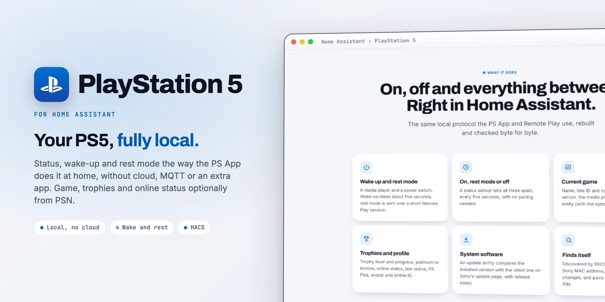

<div align="center">

<picture>
  <source media="(prefers-color-scheme: dark)" srcset="docs/images/readme-title-dark.webp" />
  
</picture>

<p>Status, wake-up and rest mode for the PS5 in Home Assistant.<br/>
Fully local, game and trophies optional.</p>

[](https://github.com/SH1FT-W/playstation-5/releases/latest)
[](https://www.home-assistant.io)
[](https://hacs.xyz)
[](https://developers.home-assistant.io/docs/creating_integration_manifest/#iot-class)
[-0070D1?style=flat-square&labelColor=111111)](custom_components/ps5/quality_scale.yaml)
[](LICENSE)

<p><a href="https://sh1ft-w.github.io/playstation-5"><b>Website</b></a> &nbsp;·&nbsp; <a href="#new">New</a> &nbsp;·&nbsp; <a href="#features">Features</a> &nbsp;·&nbsp; <a href="#entities">Entities</a> &nbsp;·&nbsp; <a href="#installation">Install</a> &nbsp;·&nbsp; <a href="#privacy">Privacy</a> &nbsp;·&nbsp; <a href="#troubleshooting">Troubleshooting</a> &nbsp;·&nbsp; <a href="CHANGELOG.md">Changelog</a></p>

</div>

<br/>

PlayStation 5 brings the **PS5** into Home Assistant over the same local protocols the PS App and Remote Play use at home: status, wake-up and rest mode **without cloud, MQTT or an extra app**. The current game, trophies and online status come optionally from the PlayStation Network, because the PS5 does not report the running game on the local network.

> [!NOTE]
> PlayStation 5 is an independent project. It is not affiliated with, endorsed by or sponsored by Sony Interactive Entertainment. PlayStation, PS5 and PlayStation Network are trademarks or registered trademarks of Sony Interactive Entertainment Inc.

<br/>

<a id="new"></a>
<sub><b>JUST ARRIVED</b></sub>
## Sturdier rest mode, safer diagnostics.

<!-- cards:new -->
<table>
<tr><td width="50%" valign="top"><picture><source media="(prefers-color-scheme: dark)" srcset="docs/images/icons/power-sleep-dark.svg"></picture> <b>Off stays off</b> <code>26.10.2</code><br>If the PS5 does not accept rest mode right away, Home Assistant retries in the background for up to 210 seconds and keeps showing off. Fully switched off meanwhile? It stops at once.</td><td width="50%" valign="top"><picture><source media="(prefers-color-scheme: dark)" srcset="docs/images/icons/shield-lock-outline-dark.svg"></picture> <b>Diagnostics without secrets</b> <code>26.10.2</code><br>Pairing keys, PSN account ID, refresh token, IP and MAC address are redacted from the diagnostics download.</td></tr>
<tr><td width="50%" valign="top"><picture><source media="(prefers-color-scheme: dark)" srcset="docs/images/icons/rocket-launch-outline-dark.svg"></picture> <b>Starts without Sony</b> <code>26.10.2</code><br>Setup no longer waits for the PSN cloud or the update page, both load in the background. Re-pairing keeps the cloud settings.</td><td width="50%" valign="top"><picture><source media="(prefers-color-scheme: dark)" srcset="docs/images/icons/calendar-outline-dark.svg"></picture> <b>Calendar versions</b> <code>26.10.1</code><br>Year, month and the release of that month: 26.10.2 is the second release of October 2026. The jump from 1.2.3 is intended, updates show up as usual.</td></tr>
</table>
<!-- /cards:new -->

Every change, release by release, in the [changelog](CHANGELOG.md).

<a id="features"></a>
## Features

<!-- cards:features -->
<table>
<tr><td width="50%" valign="top"><picture><source media="(prefers-color-scheme: dark)" srcset="docs/images/icons/power-dark.svg"></picture> <b>Wake up and rest mode</b><br>A media player and a power switch. Wake-up takes about five seconds, rest mode goes over a short Remote Play session.</td><td width="50%" valign="top"><picture><source media="(prefers-color-scheme: dark)" srcset="docs/images/icons/sony-playstation-dark.svg"></picture> <b>On, rest mode or off</b><br>A status sensor tells all three apart, every five seconds, without pairing. A silent console counts as off, not as an error.</td></tr>
<tr><td width="50%" valign="top"><picture><source media="(prefers-color-scheme: dark)" srcset="docs/images/icons/gamepad-variant-outline-dark.svg"></picture> <b>Current game</b><br>Name, title ID and cover in the game sensor, the media player and an image entity (with the optional PSN cloud).</td><td width="50%" valign="top"><picture><source media="(prefers-color-scheme: dark)" srcset="docs/images/icons/trophy-outline-dark.svg"></picture> <b>Trophies and profile</b><br>Trophy level and progress, platinum to bronze, online status, last online, PS Plus, avatar and online ID.</td></tr>
<tr><td width="50%" valign="top"><picture><source media="(prefers-color-scheme: dark)" srcset="docs/images/icons/update-dark.svg"></picture> <b>System software</b><br>An update entity compares the installed version with the latest one on Sony's update page, with release notes.</td><td width="50%" valign="top"><picture><source media="(prefers-color-scheme: dark)" srcset="docs/images/icons/magnify-dark.svg"></picture> <b>Finds itself</b><br>Discovered by DHCP host name or Sony MAC address, follows IP changes and pairs with the 8-digit PIN from the console.</td></tr>
<tr><td width="50%" valign="top"><picture><source media="(prefers-color-scheme: dark)" srcset="docs/images/icons/key-outline-dark.svg"></picture> <b>Your login stays local</b><br>NPSSO and refresh token stay in Home Assistant and only go to Sony's login servers. The login renews itself, a repair only asks when Sony rejects the NPSSO.</td><td width="50%" valign="top"><picture><source media="(prefers-color-scheme: dark)" srcset="docs/images/icons/translate-dark.svg"></picture> <b>English and German</b><br>Entity names, setup, repairs and error messages in both languages. Self-assessed against the Integration Quality Scale.</td></tr>
</table>
<!-- /cards:features -->

After switching on or off, Home Assistant shows the target state right away and waits up to 45 seconds for the console to confirm it. If the PS5 does not accept rest mode yet (shortly after waking up it reports "Remote Play busy" for about a minute), Home Assistant retries in the background after 20, 40, 60 and 90 seconds and keeps the target state meanwhile.

The entities never become "unavailable": a console that does not answer is fully off or not on the network, so it counts as **off**, not as an error. Only the optional cloud entities are unavailable without a connection to Sony.

<a id="entities"></a>
## Entities

<!-- cards:entities -->
<table>
<tr><td width="50%" valign="top"><picture><source media="(prefers-color-scheme: dark)" srcset="docs/images/icons/television-play-dark.svg"></picture> <b>Media player</b><br>media_player.playstation_5: playing (with game and cover), on or off; switch on and off.</td><td width="50%" valign="top"><picture><source media="(prefers-color-scheme: dark)" srcset="docs/images/icons/toggle-switch-outline-dark.svg"></picture> <b>Power switch</b><br>switch.playstation_5_power: on = running, off = rest mode. Handy for automations, for example switching the TV input.</td></tr>
<tr><td width="50%" valign="top"><picture><source media="(prefers-color-scheme: dark)" srcset="docs/images/icons/information-outline-dark.svg"></picture> <b>Status and game</b><br>status (on, rest mode, off, attribute changing during a command) and game (attribute title_id).</td><td width="50%" valign="top"><picture><source media="(prefers-color-scheme: dark)" srcset="docs/images/icons/update-dark.svg"></picture> <b>System software</b><br>update.playstation_5_system_software: installed against Sony's latest version. The PS5 installs it itself in rest mode.</td></tr>
<tr><td width="50%" valign="top"><picture><source media="(prefers-color-scheme: dark)" srcset="docs/images/icons/trophy-outline-dark.svg"></picture> <b>PSN cloud sensors</b><br>online_status, last_online, online_id, trophy_level, trophy_level_progress, platinum to bronze trophies, psn_login_expires.</td><td width="50%" valign="top"><picture><source media="(prefers-color-scheme: dark)" srcset="docs/images/icons/image-outline-dark.svg"></picture> <b>Images and PS Plus</b><br>game_cover and avatar as image entities, playstation_plus as a binary sensor. Only with the optional cloud.</td></tr>
</table>
<!-- /cards:entities -->

All IDs start with the device name, for example `switch.playstation_5_power`. Entity names are available in English and German.

<details>
<summary>All entity IDs (for a console named "PlayStation 5")</summary>

```
media_player.playstation_5
switch.playstation_5_power
sensor.playstation_5_status                sensor.playstation_5_game
update.playstation_5_system_software

# optional PSN cloud
sensor.playstation_5_online_status         sensor.playstation_5_last_online
sensor.playstation_5_online_id             sensor.playstation_5_psn_login_expires
sensor.playstation_5_trophy_level          sensor.playstation_5_trophy_level_progress
sensor.playstation_5_platinum_trophies     sensor.playstation_5_gold_trophies
sensor.playstation_5_silver_trophies       sensor.playstation_5_bronze_trophies
binary_sensor.playstation_5_playstation_plus
image.playstation_5_game_cover             image.playstation_5_avatar
```

</details>

## Installation

### HACS (custom repository)

1. In HACS, open the three dots menu, choose **Custom repositories** and add `https://github.com/SH1FT-W/playstation-5` with the type **Integration**.
2. Search for **PlayStation 5**, download it and restart Home Assistant.

### Manual

1. Download the [latest release](https://github.com/SH1FT-W/playstation-5/releases/latest).
2. Copy the folder `custom_components/ps5` into `/config/custom_components/` and restart Home Assistant.

Requires Home Assistant 2026.9 or newer.

## Setup

1. The console is usually discovered automatically (**Settings > Devices & services > Discovered**), by its DHCP host name `PS5-…`, its Sony MAC address or the hourly network scan. Otherwise choose **Add integration > PlayStation 5** and pick it from the list or enter its IP address. It has to be on or in rest mode.
2. On the PS5 open **Settings > System > Remote Play > Pair device** and enter the PIN shown there.
3. **PSN account ID**, three ways:
   - you know it: enter it as a number;
   - the PlayStation Network integration is set up: it is filled in already;
   - otherwise an **NPSSO token**: sign in at playstation.com, open https://ca.account.sony.com/api/v1/ssocookie and copy the value after `npsso` (or the whole line). Home Assistant uses it once to look up the account ID at Sony; this token is not stored.
4. Optional, for game, trophies and online status: **three dots > Configure** and paste an NPSSO token.

> [!TIP]
> On the PS5, **Enable Remote Play** has to be on, and under **Power Saving > Features Available in Rest Mode** both **Stay Connected to the Internet** and **Enable Turning On PS5 from Network**. Otherwise it cannot be woken from rest mode.

If the console gets a new IP address later, use **three dots > Reconfigure** (known consoles are also found again by DHCP).

<a id="privacy"></a>
## Privacy

- **Control is local.** Status, wake-up and rest mode go straight between Home Assistant and the console. Nothing passes through a cloud.
- **Your PSN login stays in Home Assistant.** An NPSSO token entered during setup only looks up the account ID and is not stored. For the optional cloud, Home Assistant keeps the NPSSO token and a refresh token in its own config entry. Sony's refresh token runs out a fixed 10 days after it was issued, so Home Assistant uses the stored NPSSO to fetch a new one 3 days before. Tokens are sent to Sony's own login and PSN servers only, never anywhere else.
- **Diagnostics redact secrets.** Pairing keys, NPSSO and refresh tokens, account IDs, IP and MAC address are left out of the diagnostics download.
- **Expiry is visible.** The sensor "PSN login expires" shows when the current refresh token runs out; it moves on by itself with every renewal. Only when Sony rejects the stored NPSSO (it lasts about two months, or until you sign out at Sony) does a repair with an input field for a new token appear. Logins set up before 26.10.3 have no stored NPSSO yet: the repair shows up once more, after that it renews itself.

## Example

Switch the TV to the console's input when the PS5 starts:

```yaml
triggers:
  - trigger: state
    entity_id: switch.playstation_5_power
    to: "on"
actions:
  - action: media_player.select_source
    target:
      entity_id: media_player.living_room_tv
    data:
      source: HDMI 2
```

## Good to know

- **Wake-up works from rest mode only**, not when the console is fully off.
- **No current game without the cloud.** Unlike the PS4, the PS5 does not report it locally.
- **System updates** are installed by the PS5 itself in rest mode ("Install automatically" in its settings). The update entity only shows whether one is available.
- **No game launching or button presses.** That would need a full Remote Play session.
- **Do not poll Remote Play.** Every session reserves Remote Play on the console for about a minute, so the integration only opens one to switch off. The status comes from the discovery protocol.

## Troubleshooting

- **"The PS5 is not waiting for pairing".** Keep **Pair device** open on the PS5 until Home Assistant has finished.
- **Switching off says the pairing is no longer known.** The device was removed on the PS5 under Remote Play. Home Assistant asks for a new PIN.
- **Wake-up does nothing.** Check the rest mode settings above; a console that was fully off cannot be woken.
- **Cloud entities unavailable.** Sony is not reachable or the login expired; check the repairs.
- **Diagnostics:** **Settings > Devices & services > PlayStation 5 > three dots > Download diagnostics**. Keys, tokens, account IDs, IP and MAC address are redacted.
- **Debug log:**

  ```yaml
  logger:
    logs:
      custom_components.ps5: debug
  ```

When you open an [issue](https://github.com/SH1FT-W/playstation-5/issues), please attach the diagnostics file. Never post your NPSSO token.

## Removal

1. **Settings > Devices & services > PlayStation 5 > three dots > Delete**.
2. On the PS5, remove the paired device under **Settings > System > Remote Play**.
3. Delete the folder `/config/custom_components/ps5` (or remove the repository in HACS) and restart Home Assistant.

## How it works

<!-- cards:how -->
<table>
<tr><td width="33%" valign="top"><picture><source media="(prefers-color-scheme: dark)" srcset="docs/images/icons/radar-dark.svg"></picture> <b>DDP, UDP 9302</b><br>Status and wake-up, the way the PS App finds the console at home. Every 5 seconds.</td><td width="33%" valign="top"><picture><source media="(prefers-color-scheme: dark)" srcset="docs/images/icons/remote-dark.svg"></picture> <b>Remote Play, TCP 9295</b><br>One-time pairing with the PIN, then a short session that only sends rest mode.</td><td width="33%" valign="top"><picture><source media="(prefers-color-scheme: dark)" srcset="docs/images/icons/cloud-outline-dark.svg"></picture> <b>PSN, optional</b><br>Game, trophies and profile from Sony once a minute. Control never goes through the cloud.</td></tr>
</table>
<!-- /cards:how -->

Status every 5 seconds, the PSN cloud once a minute, Sony's update page every 6 hours.

The Remote Play handshake (pairing, wake-up credential, rest mode session) is re-implemented after [pyremoteplay](https://github.com/ktnrg45/pyremoteplay) by ktnrg45, and the key tables in `keys.py` are taken from it; pyremoteplay builds on [Chiaki](https://git.sr.ht/~thestr4ng3r/chiaki). The PSN sign-in uses the same public PS App client parameters as [PSNAWP](https://github.com/isFakeAccount/psnawp). Thanks for the groundwork. Details are in [`NOTICE`](NOTICE); protocol notes, including the console's pitfalls, are in [`CLAUDE.md`](CLAUDE.md) (German).

## Development

```bash
python -m pytest -q -p no:logging        # fake PS5 on localhost in tests/fake_ps5.py, no console needed
uvx ruff check . && uvx ruff format --check .
uvx mypy@2.3.1 --python-executable <venv>/bin/python
python tools/pruefe-uebersetzungen.py    # strings.json against translations/*.json
```

Install the test requirements with `pip install -r requirements_test.txt`. The same checks run on GitHub Actions for every push and pull request, plus HACS validation and hassfest.

## License

[GNU General Public License v3.0](LICENSE), Copyright 2026 SH1FT-W.

Because the Remote Play protocol and key tables come from pyremoteplay (GPLv3), the whole integration is licensed under the GPLv3. See [`NOTICE`](NOTICE) for the third-party material and trademarks.
